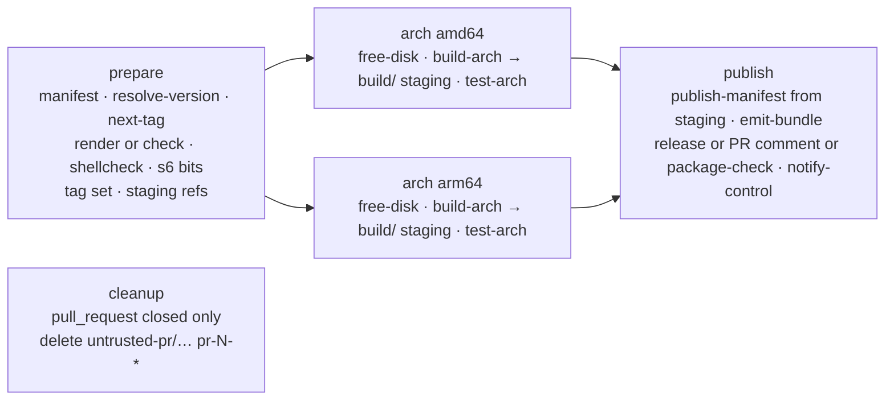

# workflows

The shared GitHub Actions build system of the LinuxServer.io v2 playground. Every `docker-<name>`
repository in `linuxserver-playground` carries a short generated `.github/workflows/build.yml` that
calls `image-build.yml` from this repo at `v1`; this repo holds everything the build does. It replaces the
1,800-line Jenkinsfile and implements the contract in
[`linuxserver-playground/builder/CONVENTIONS.md`](https://github.com/linuxserver-playground/builder/blob/main/CONVENTIONS.md)
(sections 2 to 10) and its schemas (`image`, `bundle`, `control-event`).

Only GHCR under `ghcr.io/linuxserver-playground/` is written to. Base images are read from
`ghcr.io/linuxserver/baseimage-*`. There is no Docker Hub, GitLab, Quay, S3 or Discord here; notifications
are the control plane's job.

## Layout

| Path | What |
| --- | --- |
| `.github/workflows/image-build.yml` | The reusable image build (`workflow_call`). |
| `.github/workflows/mod-build.yml` | Reusable build for `docker-mods` branches. |
| `.github/workflows/cleanup-staging.yml` | Weekly deletion of `build/*` staging images older than 7 days (runs in this repo). |
| `.github/workflows/ci.yml` | Checks of this repository. |
| `.github/actions/<name>/` | Composite actions; the logic lives in the script beside each `action.yml`. |
| `scripts/` | Shared code: `lib.sh` (bash helpers, `retry_ghcr`), `resolve_version.py`, `next_tag.py`, `tags.py`, `package_versions.py`, `upstream_notes.py`, `pr_comment.py`, `pr_cleanup.py`, `cleanup_staging.py`, the prepare-job scripts, `check.sh`. |
| `templates/build.yml` | The caller file the builder renders into image repos. |
| `fixtures/example-image/` | A minimal valid image repository for integration runs. |
| `tests/` | pytest over every Python script plus static checks of the YAML. |

## Job graph



**prepare** (`ubuntu-24.04`) reads `image.yml` with the `manifest` action (validated with the contracts
package), decides the mode (`pr` for pull requests, `live` when the pushed branch is `release.branch`,
otherwise `dev`), detects fork pull requests (`push_images=false`), resolves the upstream version, reads the
next `-lsN` from the branch's GitHub Releases (live only), runs the builder container (`render` plus one
`Update generated files [skip ci]` commit on live branches; `check` on pr and dev, failing on drift), runs
shellcheck over `root/` and checks the s6 executable bits, and emits the platform matrix, the full tag set and
the per-arch staging references `ghcr.io/<org>/build/<name>:<arch>-<sha7>-<run id>`.

**arch** (matrix, `ubuntu-24.04` for amd64 and `ubuntu-24.04-arm` for arm64, `fail-fast: false`) injects
`ENV LSIO_FIRST_PARTY=true` after `FROM`, builds with every label of CONVENTIONS §5, `--no-cache --pull`,
`--provenance=mode=max --sbom=true` when pushing, pushes the image to its **staging reference** (never to a
released tag) and records the platform digest, or `docker save`s the image into the `image-<arch>` artifact
for fork pull requests. Then it runs the ci container (below) against exactly that reference and uploads
`out/` as the `bundle-<arch>` artifact whatever the test result. Test failure fails the arch job after the
upload.

**publish** (`ubuntu-24.04`, `if: always()`) merges the per-arch artifacts and, only when prepare and every
arch job succeeded, creates the multi-platform indexes and arch twins for the whole tag set from the staging
references (`publish-manifest`; `imagetools create` tags a manifest across repositories of the same
registry, so a run that fails anywhere leaves every released tag untouched). It then writes and validates
`build.json` (`emit-bundle`), attests the index (live), creates the git tag at the built commit and the
GitHub Release on the branch (`target_commitish` is the branch name, CONVENTIONS §3) with the three-section
notes and every bundle asset (`release`, live only), posts or updates the single PR comment (pr), POSTs the
signed `build.summary` event to the control plane (`notify-control`, always; silent when `CONTROL_URL` is
empty), writes the job summary, and finally fails if any job failed. With `reason: packages` on a live
branch the publish and release steps are replaced by `package-check` (below).

**cleanup** runs alone when a pull request is closed (prepare, arch and publish are skipped): it deletes
every `untrusted-pr/<name>` package version tagged `pr-<number>-*`, arch twins included. `GITHUB_TOKEN`
with `packages: write` is tried first; when the registry refuses, `PACKAGES_TOKEN` (`delete:packages` on
the organisation) is used if the caller has it, otherwise the job warns and leaves the images to the control
plane.

### Reasons

`inputs.reason` says why a run exists. It is recorded in `build.json` and the control event; only
`packages` changes what the run does.

| Reason | Set by | Live branch | Other branches / PRs |
| --- | --- | --- | --- |
| `push` | the caller's default for `push` events | normal build and release | dev or pr build |
| `upstream` | control plane (`repository_dispatch`) or `workflow_dispatch` after a new upstream version | normal build and release | dev build |
| `packages` | control plane's weekly package check or `workflow_dispatch` | build and test, then **compare, never release** (below) | plain dev build; nothing is compared |
| `rebuild` | control plane or `workflow_dispatch` (base image change, bad release) | normal build and release; same `-lsN` when HEAD is already released | dev build |
| `manual` | `workflow_dispatch` default | normal build and release | dev build |
| `pull_request` | derived: every pr-mode build reports this whatever the input | n/a | pr build |

**`packages` on a live branch** (Jenkins parity with the `Update-packages` stage): prepare, build and test run
as normal because the fresh image is needed to know its packages. Then `package-check` compares the fresh
`package_versions.amd64.txt` with the committed `package_versions.txt` (the amd64 table) at the built commit,
by md5 with trailing whitespace normalised, and compares arm64 against the previous release's
`package_versions.arm64.txt` asset for reporting only.

- Unchanged: nothing is published or released; the bundle is a workflow artifact only; `build.summary` says
  `result: skipped` (no `failed_job`); the job summary says "packages unchanged"; the run succeeds.
- Changed, or no `package_versions.txt` in the repo yet: the fresh amd64 table is committed to the live
  branch as `Update package versions` (fetch, rebase, push, retried), and the check run then dispatches the
  normal release build for the branch with `workflow_dispatch` (a push made with the workflow token never
  triggers workflows, so the dispatch is explicit; the caller grants `actions: write` for it). The check run
  itself publishes and releases nothing and reports `result: success`. The follow-up build runs on the new
  HEAD, which no release tag points at, so it gets `-ls<N+1>`. A push that still fails after the retries
  fails the run; a failed dispatch is a warning (the control plane's next check catches up).

On a normal live release the committed `package_versions.txt` may lag the image: the release build does not
commit it, only the next package check does. The authoritative table of a release is its
`package_versions.<arch>.txt` asset.

### Bot commits

The workflow makes exactly two kinds of commit on live branches (CONVENTIONS §8), both as
`github-actions[bot]`:

| Subject | Made by | Starts a build? |
| --- | --- | --- |
| `Update generated files [skip ci]` | prepare, after `builder render` changed README, AGENTS.md, LICENSE or the caller workflow | No. The run that made it continues on it, so another run would only rebuild the same tree (and, when HEAD was already released, overwrite the same `-lsN`); `[skip ci]` makes GitHub skip the push event. |
| `Update package versions` | `package-check`, when the package table changed | Yes, deliberately: that build is the release. |

## Modes, namespaces, tags

| Mode | Image | Tags |
| --- | --- | --- |
| live | `ghcr.io/linuxserver-playground/<name>` | `T`, `[T-]<upstream>-ls<N>`, `[T-]version-<upstream>`, `[T-]<semver>`, and `amd64-`/`arm64v8-` twins |
| dev | `ghcr.io/linuxserver-playground/dev/<name>` | `<branch>-<sha7>` and twins |
| pr | `ghcr.io/linuxserver-playground/untrusted-pr/<name>` | `pr-<n>-<sha7>` and twins |
| any (staging) | `ghcr.io/linuxserver-playground/build/<name>` | `<arch>-<sha7>-<run id>`, one per platform and run |

`T` is `release.tag` (`latest` on the default branch, in which case the prefix is omitted). The git tag and
Release are `[T-]<upstream>-ls<N>`; the tag is created at the built commit and the Release's
`target_commitish` is the branch name. `N` comes from the newest Release of the branch (`next_tag.py`), plus
one unless HEAD already carries that release's tag.

`build/` is where every arch job pushes, whatever the mode, before anything is known about the outcome.
Consumers never use it: the images carry the index annotation
`org.opencontainers.image.description=Intermediate build artefact, not for use` (an annotation, not a label,
because `imagetools create` copies the image config into the released repository unchanged), the staging
references appear in the job summary only, and `cleanup-staging.yml` deletes versions older than 7 days
every Monday (or on `workflow_dispatch`, with `dry_run`). Deleting organisation package versions needs
`delete:packages`, which `GITHUB_TOKEN` does not have, so that workflow uses the `PACKAGES_TOKEN` secret and
skips with a warning when it is absent.

## CI container interface

The `test-arch` action runs exactly this; the `ci` repo implements the other side.

```
docker run --rm \
  -v /var/run/docker.sock:/var/run/docker.sock \
  -v "$OUT":/out \
  -e IMAGE="<image ref present in the local docker daemon>" \
  -e ARCH="amd64|arm64" \
  -e MODE="live|dev|pr" \
  -e MANIFEST_JSON="<image.yml as compact JSON>" \
  -e PREVIOUS_PACKAGES_URL="<optional URL of the previous release's package_versions.<arch>.txt>" \
  ghcr.io/linuxserver-playground/ci:latest
```

It writes into `/out`: `test.<arch>.json` (test-report schema), `test.<arch>.tar.gz`,
`packages.<arch>.json.gz`, `files.<arch>.json.gz`, `layers.<arch>.json`, `package_versions.<arch>.txt`,
`image-config.<arch>.json` (`docker image inspect` output) and `init-graph.<arch>.json`. Exit code 0 even
when tests fail (the report says so); non-zero only when the harness itself broke. The image is configurable
through the `ci_image` input until the ci image is published.

`build-arch` adds `arch.<arch>.json` (digest, sizes, labels, runner, build time, Dockerfile as built) and
`dockerfile.<arch>` to the same directory; `emit-bundle` turns the lot into `build.json`.

## Using it from an image repository

`templates/build.yml` is what the builder renders; it is the whole caller:

```yaml
jobs:
  build:
    uses: linuxserver-playground/workflows/.github/workflows/image-build.yml@v1
    permissions: { contents: write, packages: write, pull-requests: write, id-token: write, attestations: write }
    with:
      reason: ${{ github.event.inputs.reason || github.event.client_payload.reason || 'push' }}
      workflows_ref: v1
    secrets: inherit
```

Inputs: `reason` (`push`, `upstream`, `packages`, `rebuild`, `manual`; see "Reasons"), `workflows_ref` (must
match the ref in `uses:`; the composite actions are checked out from it), `ci_image`, `builder_image` (empty
skips templating), `builder_ref`. Secrets (organisation level, absent in forks, all optional): `CONTROL_URL`,
`CONTROL_EVENTS_SECRET`, `PACKAGES_TOKEN` (only for deleting the images of closed pull requests when
`GITHUB_TOKEN` may not). `GITHUB_TOKEN` is enough for GHCR, Releases, the two bot commits and PR comments.

The caller subscribes to `pull_request` with `types: [opened, synchronize, reopened, closed]`: the first
three build, `closed` runs only the cleanup job. The control plane triggers builds with `repository_dispatch`
(`types: [build]`, `client_payload.reason`) or `workflow_dispatch`. Of the two commits the workflow makes,
`Update generated files [skip ci]` never starts another run and `Update package versions` is meant to.

### Version sources

`scripts/resolve_version.py` implements every `upstream.version.type` of the image schema: `github_release`
(with `prerelease` and `exclude`), `github_commit`, `gitlab_commit`, `codeberg_release`, `gitea_release`,
`json` (via the `jq` binary), `npm`, `pip`, `alpine_apk` (APKINDEX of every build platform must agree),
`deb_packages`, `deb_repo` (`docker run` + `apt-cache`), `blob` (md5), `os` (md5 of `package_versions.txt`)
and `command`; then `transform`, sanitising (`~ , % @ + ; : /` and spaces removed), semver derivation and
`require_assets`. It has no Actions coupling so the control plane's scheduler imports the same file:

```python
from resolve_version import resolve, load_manifest
resolve(load_manifest("image.yml"), manifest_dir=".")
# {'upstream': 'v4.0.20.3014', 'upstream_clean': 'v4.0.20.3014', 'semver': '4.0.20', 'source': 'json', 'source_url': '...'}
```

Exit codes of the CLI: 0 resolved, 1 error, 3 assets not ready (try later).

## Mods

`mod-build.yml` (inputs `name`, `target`, `multi_arch`, `mod_version`) builds a `docker-mods` branch named
`<target>-<name>` and pushes `ghcr.io/linuxserver-playground/mods:<target>-<name>` and `:<target>-<name>-<sha7>`
(plus `-<mod_version>` variants) on push to that branch, and
`ghcr.io/linuxserver-playground/untrusted-pr/mods:<target>-<name>-pr-<n>` for pull requests. arm64 is built
natively. `scripts/pr_cleanup.py` also understands the `*-pr-<n>` mod tags; the image workflow's cleanup job
is the only caller today.

## Known limits

- `GITHUB_TOKEN` cannot update `.github/workflows/build.yml`. When `render` changes it, the other generated
  files are committed and a warning asks the control plane (a GitHub App with `workflows` permission) to
  update the workflow file.
- The hub is not dispatched from here: `GITHUB_TOKEN` cannot send `repository_dispatch` to another
  repository. The `build.summary` event goes to the control plane, which dispatches `image-released` to the
  hub with its App token; the hub also reconciles hourly (CONVENTIONS §9).
- Matrix job outputs collide, so the per-arch test result travels in the `bundle-<arch>` artifacts
  (`test.<arch>.json`); the `test_success_<arch>` job outputs are a convenience.
- The `Update package versions` commit is pushed with `GITHUB_TOKEN`. GitHub documents that pushes made with
  the workflow token do not start `push` workflows; if the follow-up release build does not appear, the
  control plane (which sees the push webhook and the `build.summary` with `reason: packages` and
  `result: success`) must dispatch it, or the push needs an App or PAT credential.
- Staging images in `build/` accumulate until `cleanup-staging.yml` runs with `PACKAGES_TOKEN`; without the
  secret they stay (they are small manifests sharing layers with the released images).
- The job summary and the control event carry `build.json`; the test report link in release notes points at
  `${CONTROL_URL}/builds/<repo>/<run id>` (the control plane's route) or the workflow run when no control
  plane is configured.

## Third-party actions

All pinned by major tag:

- `actions/checkout@v5`
- `actions/upload-artifact@v4`
- `actions/download-artifact@v5`
- `actions/setup-python@v5`
- `actions/attest-build-provenance@v2`
- `docker/setup-buildx-action@v3`
- `docker/login-action@v3`

## Developing

```bash
python3 -m venv .venv && .venv/bin/pip install -e '.[dev]'
./scripts/check.sh          # shellcheck, actionlint, pytest, contracts
```

The tests mock every HTTP call; nothing here needs network or docker. `tests/test_workflow_files.py` keeps
every action pinned and listed above, and refuses references outside `linuxserver-playground`.

## Cutting `v1`

Image repos call `@v1`, a moving major tag. After merging to `main`:

```bash
git tag -f v1 && git push -f origin v1
```

A breaking change to inputs, outputs, the ci interface or the bundle becomes `v2`, and the builder's
`templates/build.yml` is bumped so re-rendered repos move over.
