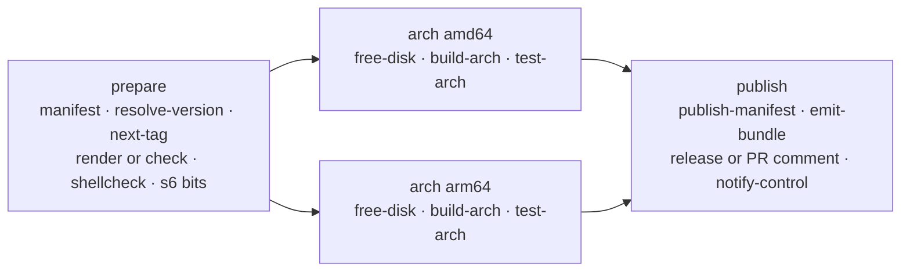

# workflows

The shared GitHub Actions build system of the LinuxServer.io v2 playground. Every `docker-<name>`
repository in `linuxserver-playground` carries a ~30 line generated `.github/workflows/build.yml` that
calls `image-build.yml` from this repo at `v1`; this repo holds everything the build does. It replaces the
1,800-line Jenkinsfile and implements the contract in
[`linuxserver-playground/builder/CONVENTIONS.md`](https://github.com/linuxserver-playground/builder/blob/main/CONVENTIONS.md)
(sections 2 to 10) and its schemas (`image`, `bundle`, `control-event`).

Only GHCR under `ghcr.io/linuxserver-playground/` is written to. Base images are read from
`ghcr.io/linuxserver/baseimage-*`. There is no Docker Hub, GitLab, Quay, S3 or Discord here; notifications
are the control plane's job.

## Layout

| Path | What |
| --- | --- |
| `.github/workflows/image-build.yml` | The reusable image build (`workflow_call`). |
| `.github/workflows/mod-build.yml` | Reusable build for `docker-mods` branches. |
| `.github/workflows/pr-cleanup.yml` | Deletes `untrusted-pr/*` images when a pull request closes. |
| `.github/workflows/ci.yml` | Checks of this repository. |
| `.github/actions/<name>/` | Composite actions; the logic lives in the script beside each `action.yml`. |
| `scripts/` | Shared code: `lib.sh` (bash helpers, `retry_ghcr`), `resolve_version.py`, `next_tag.py`, `tags.py`, `upstream_notes.py`, `pr_comment.py`, `pr_cleanup.py`, the prepare-job scripts, `check.sh`. |
| `templates/build.yml` | The caller file the builder renders into image repos. |
| `fixtures/example-image/` | A minimal valid image repository for integration runs. |
| `tests/` | pytest over every Python script plus static checks of the YAML. |

## Job graph



**prepare** (`ubuntu-24.04`) reads `image.yml` with the `manifest` action (validated with the contracts
package), decides the mode (`pr` for pull requests, `live` when the pushed branch is `release.branch`,
otherwise `dev`), detects fork pull requests (`push_images=false`), resolves the upstream version, reads the
next `-lsN` from the branch's GitHub Releases (live only), runs the builder container (`render` plus one
`Update generated files` commit on live branches; `check` on pr and dev, failing on drift), runs shellcheck
over `root/` and checks the s6 executable bits, and emits the platform matrix and the full tag set.

**arch** (matrix, `ubuntu-24.04` for amd64 and `ubuntu-24.04-arm` for arm64, `fail-fast: false`) injects
`ENV LSIO_FIRST_PARTY=true` after `FROM`, builds with every label of CONVENTIONS §5, `--no-cache --pull`,
`--provenance=mode=max --sbom=true` when pushing, pushes `<image>:<arch>-<primary tag>` and records the
platform digest, or `docker save`s the image into the `image-<arch>` artifact for fork pull requests. Then it
runs the ci container (below) and uploads `out/` as the `bundle-<arch>` artifact whatever the test result.
Test failure fails the arch job after the upload.

**publish** (`ubuntu-24.04`, `if: always()`) merges the per-arch artifacts, creates the multi-platform
indexes and arch twins for the whole tag set (`publish-manifest`), writes and validates `build.json`
(`emit-bundle`), attests the index (live), creates the git tag and GitHub Release with the three-section
notes and uploads every bundle asset (`release`, live only), posts or updates the single PR comment (pr), POSTs
the signed `build.summary` event to the control plane (`notify-control`, always; silent when `CONTROL_URL`
is empty), writes the job summary, and finally fails if any job failed.

## Modes, namespaces, tags

| Mode | Image | Tags |
| --- | --- | --- |
| live | `ghcr.io/linuxserver-playground/<name>` | `T`, `[T-]<upstream>-ls<N>`, `[T-]version-<upstream>`, `[T-]<semver>`, and `amd64-`/`arm64v8-` twins |
| dev | `ghcr.io/linuxserver-playground/dev/<name>` | `<branch>-<sha7>` and twins |
| pr | `ghcr.io/linuxserver-playground/untrusted-pr/<name>` | `pr-<n>-<sha7>` and twins |

`T` is `release.tag` (`latest` on the default branch, in which case the prefix is omitted). The git tag and
Release are `[T-]<upstream>-ls<N>`. `N` comes from the newest Release of the branch (`next_tag.py`), plus one
unless HEAD already carries that release's tag.

## CI container interface

The `test-arch` action runs exactly this; the `ci` repo implements the other side.

```
docker run --rm \
  -v /var/run/docker.sock:/var/run/docker.sock \
  -v "$OUT":/out \
  -e IMAGE="<image ref present in the local docker daemon>" \
  -e ARCH="amd64|arm64" \
  -e MODE="live|dev|pr" \
  -e MANIFEST_JSON="<image.yml as compact JSON>" \
  -e PREVIOUS_PACKAGES_URL="<optional URL of the previous release's package_versions.<arch>.txt>" \
  ghcr.io/linuxserver-playground/ci:latest
```

It writes into `/out`: `test.<arch>.json` (test-report schema), `test.<arch>.tar.gz`,
`packages.<arch>.json.gz`, `files.<arch>.json.gz`, `layers.<arch>.json`, `package_versions.<arch>.txt`,
`image-config.<arch>.json` (`docker image inspect` output) and `init-graph.<arch>.json`. Exit code 0 even
when tests fail (the report says so); non-zero only when the harness itself broke. The image is configurable
through the `ci_image` input until the ci image is published.

`build-arch` adds `arch.<arch>.json` (digest, sizes, labels, runner, build time, Dockerfile as built) and
`dockerfile.<arch>` to the same directory; `emit-bundle` turns the lot into `build.json`.

## Using it from an image repository

`templates/build.yml` is what the builder renders; it is the whole caller:

```yaml
jobs:
  build:
    uses: linuxserver-playground/workflows/.github/workflows/image-build.yml@v1
    permissions: { contents: write, packages: write, pull-requests: write, id-token: write, attestations: write }
    with:
      reason: ${{ github.event.inputs.reason || github.event.client_payload.reason || 'push' }}
      workflows_ref: v1
    secrets: inherit
```

Inputs: `reason` (`push`, `upstream`, `packages`, `rebuild`, `manual`), `workflows_ref` (must match the ref in
`uses:`; the composite actions are checked out from it), `ci_image`, `builder_image` (empty skips templating),
`builder_ref`. Secrets (organisation level, absent in forks): `CONTROL_URL`, `CONTROL_EVENTS_SECRET`.
`GITHUB_TOKEN` is enough for GHCR, Releases and PR comments.

The control plane triggers builds with `repository_dispatch` (`types: [build]`, `client_payload.reason`) or
`workflow_dispatch`. Pushes by the workflow (the `Update generated files` commit) never start another run.

### Version sources

`scripts/resolve_version.py` implements every `upstream.version.type` of the image schema: `github_release`
(with `prerelease` and `exclude`), `github_commit`, `gitlab_commit`, `codeberg_release`, `gitea_release`,
`json` (via the `jq` binary), `npm`, `pip`, `alpine_apk` (APKINDEX of every build platform must agree),
`deb_packages`, `deb_repo` (`docker run` + `apt-cache`), `blob` (md5), `os` (md5 of `package_versions.txt`)
and `command`; then `transform`, sanitising (`~ , % @ + ; : /` and spaces removed), semver derivation and
`require_assets`. It has no Actions coupling so the control plane's scheduler imports the same file:

```python
from resolve_version import resolve, load_manifest
resolve(load_manifest("image.yml"), manifest_dir=".")
# {'upstream': 'v4.0.20.3014', 'upstream_clean': 'v4.0.20.3014', 'semver': '4.0.20', 'source': 'json', 'source_url': '...'}
```

Exit codes of the CLI: 0 resolved, 1 error, 3 assets not ready (try later).

## Mods and pull request cleanup

`mod-build.yml` (inputs `name`, `target`, `multi_arch`, `mod_version`) builds a `docker-mods` branch named
`<target>-<name>` and pushes `ghcr.io/linuxserver-playground/mods:<target>-<name>` and `:<target>-<name>-<sha7>`
(plus `-<mod_version>` variants) on push to that branch, and
`ghcr.io/linuxserver-playground/untrusted-pr/mods:<target>-<name>-pr-<n>` for pull requests. arm64 is built
natively.

`pr-cleanup.yml` (call it on `pull_request: closed`) deletes every version of `untrusted-pr/<name>` tagged
`pr-<n>-*` (or `*-pr-<n>` for mods) through the packages API. Deleting organisation package versions needs
`delete:packages`, which `GITHUB_TOKEN` does not have; pass `PACKAGES_TOKEN` or let the control plane do it.

## Known limits

- `GITHUB_TOKEN` cannot update `.github/workflows/build.yml`. When `render` changes it, the other generated
  files are committed and a warning asks the control plane (a GitHub App with `workflows` permission) to
  update the workflow file.
- The hub is not dispatched from here: `GITHUB_TOKEN` cannot send `repository_dispatch` to another
  repository. The `build.summary` event goes to the control plane, which dispatches `image-released` to the
  hub with its App token; the hub also reconciles hourly (CONVENTIONS §9).
- Matrix job outputs collide, so the per-arch test result travels in the `bundle-<arch>` artifacts
  (`test.<arch>.json`); the `test_success_<arch>` job outputs are a convenience.
- The job summary and the control event carry `build.json`; the test report link in release notes points at
  `${CONTROL_URL}/builds/<repo>/<run id>` (the control plane's route) or the workflow run when no control
  plane is configured.

## Third-party actions

All pinned by major tag:

- `actions/checkout@v5`
- `actions/upload-artifact@v4`
- `actions/download-artifact@v5`
- `actions/setup-python@v5`
- `actions/attest-build-provenance@v2`
- `docker/setup-buildx-action@v3`
- `docker/login-action@v3`

## Developing

```bash
python3 -m venv .venv && .venv/bin/pip install -e '.[dev]'
./scripts/check.sh          # shellcheck, actionlint, pytest, contracts
```

The tests mock every HTTP call; nothing here needs network or docker. `tests/test_workflow_files.py` keeps
every action pinned and listed above, and refuses references outside `linuxserver-playground`.

## Cutting `v1`

Image repos call `@v1`, a moving major tag. After merging to `main`:

```bash
git tag -f v1 && git push -f origin v1
```

A breaking change to inputs, outputs, the ci interface or the bundle becomes `v2`, and the builder's
`templates/build.yml` is bumped so re-rendered repos move over.
