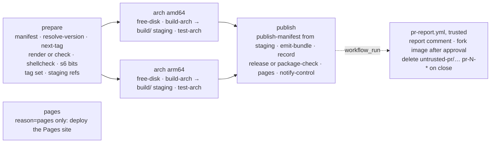

# workflows

The shared GitHub Actions build system of the LinuxServer.io v2 playground. Every `docker-<name>`
repository in `linuxserver-playground` carries a short generated `.github/workflows/build.yml` that
calls `image-build.yml` from this repo at `v1`; this repo holds everything the build does. It replaces the
1,800-line Jenkinsfile and implements the contract in
[`linuxserver-playground/builder/CONVENTIONS.md`](https://github.com/linuxserver-playground/builder/blob/main/CONVENTIONS.md)
(sections 2 to 10) and its schemas (`image`, `bundle`, `control-event`).

Only GHCR under `ghcr.io/linuxserver-playground/` is written to. Base images are read from
`ghcr.io/linuxserver/baseimage-*`. There is no Docker Hub, GitLab, Quay, S3 or Discord here; notifications
are the control plane's job.

## Layout

| Path | What |
| --- | --- |
| `.github/workflows/image-build.yml` | The reusable image build (`workflow_call`). |
| `.github/workflows/pr-report.yml` | The trusted half of pull request builds (`workflow_call` from each image repo's generated `pr-report.yml`): the report comment, publishing an approved fork's image, deleting a closed pull request's images. |
| `.github/workflows/mod-build.yml` | Reusable build for `docker-mods` branches. |
| `.github/workflows/cleanup-staging.yml` | Weekly deletion of `build/*` staging images older than 7 days (runs in this repo). |
| `.github/workflows/ci.yml` | Checks of this repository. |
| `.github/actions/<name>/` | Composite actions; the logic lives in the script beside each `action.yml`. |
| `scripts/` | Shared code: `lib.sh` (bash helpers, `retry`, `retry_ghcr`), `netretry.py` (their Python twin), `install_builder.sh`, `resolve_version.py`, `mod_version.py`, `next_tag.py`, `tags.py`, `package_versions.py`, `upstream_notes.py`, `attach_sbom.py`, `pr_report.py`, `pages.py`, `publish_pr_image.sh`, `pr_cleanup.py`, `cleanup_staging.py`, the prepare-job scripts, `check.sh`. |
| `templates/build.yml`, `templates/pr-report.yml` | The caller files the builder renders into image repos. |
| `fixtures/example-image/` | A minimal valid image repository for integration runs. |
| `tests/` | pytest over every Python script plus static checks of the YAML. |

## Job graph



**prepare** (`ubuntu-24.04`) reads `image.yml` with the `manifest` action (validated with the contracts
package), decides the mode (`pr` for pull requests, `live` when the pushed branch is `release.branch`,
otherwise `dev`), detects fork pull requests (`push_images=false`), resolves the upstream version, reads the
next `-lsN` from the branch's GitHub Releases (live only), runs the builder container (`render` plus one
`Update generated files [skip ci]` commit on live branches; `check` on pr and dev, failing on drift), runs
shellcheck over `root/` and checks the s6 executable bits, and emits the platform matrix, the full tag set and
the per-arch staging references `ghcr.io/<org>/build/<name>:<arch>-<sha7>-<run id>`.

**arch** (matrix, `ubuntu-24.04` for amd64 and `ubuntu-24.04-arm` for arm64, `fail-fast: false`) injects
`ENV LSIO_FIRST_PARTY=true` after `FROM`, builds with every label of CONVENTIONS §5, `--no-cache --pull`,
`--provenance=mode=max --sbom=false` when pushing (BuildKit's SBOM scan records every file and outgrew its
80 MiB attestation limit on desktop images), pushes the image to its **staging reference** (never to a
released tag) and records the platform digest, or `docker save`s the image into the `image-<arch>` artifact
for fork pull requests. Then it runs the ci container (below) against exactly that reference and uploads
`out/` as the `bundle-<arch>` artifact whatever the test result. Test failure fails the arch job after the
upload.

**publish** (`ubuntu-24.04`, `if: always()`) merges the per-arch artifacts and, only when prepare and every
arch job succeeded, creates the multi-platform indexes and arch twins for the whole tag set from the staging
references (`publish-manifest`; `imagetools create` tags a manifest across repositories of the same
registry, so a run that fails anywhere leaves every released tag untouched). Before that, each arch's
packages-only `sbom.<arch>.spdx.json` from the ci run is added to the staging reference's attestation manifest
next to the provenance (`scripts/attach_sbom.py`, in BuildKit's in-toto layout), so every released tag carries
it and `docker buildx imagetools inspect --format '{{json .SBOM}}'` shows it. It then writes and validates
`build.json` (`emit-bundle`, with `published`: the image and every tag publish-manifest created, which readers take
a build's tags from instead of listing the registry), derives `record.json` from the bundle files (`record`: `builder record` with the
package tables, the diff against the previous release, a grype scan of both architectures and the base image's
layers; about a minute, never fatal; CONVENTIONS §6), attests the index (live), creates the git tag at the built commit and the
GitHub Release on the branch (`target_commitish` is the branch name, CONVENTIONS §3) with the three-section
notes and every bundle asset (`release`, live only), posts or updates the single PR comment (pr), deploys the
repository's Pages site after a live release (`pages`, below; never fatal), POSTs the signed `build.summary`
event to the control plane (`notify-control`, always; silent when `CONTROL_URL` is empty; `pages` in it is
`deployed`, `failed` or `skipped`), writes the job summary, and finally fails if any job failed. The job summary is the run page's only
summary box (control's notifications link it as `#summary-<job id>`): the result, then, on a branch or live
build, the report a pull request gets as its comment (`scripts/pr_report.py summary`: the pull command,
screenshots and tests first, then runtime, package changes against the release before it or the live
branch's newest, log tails; it never fails the build), then the build details collapsed. Steps write their
notes to `LSIO_SUMMARY` (`summary` in `lib.sh`, `gha.summary`): a file the Publish job puts under the
report, and the log in every other job. With `reason: packages` on a live
branch the publish and release steps are replaced by `package-check` (below).

### Pull requests: the trusted half

The build of a pull request runs the pull request's code (its Dockerfile, its image), so it never holds a
secret or a write token on behalf of a fork, and it never posts to the pull request. Everything that needs
either lives in `pr-report.yml`, called by each image repo's generated `pr-report.yml` on `workflow_run` (a
Build finished) and `pull_request_target` (`labeled`, `synchronize`, `closed`). Both events run the base
branch's workflow, and no job in it checks out, builds or runs pull request code.

- **report** finds the pull request and its Build run through the API (`scripts/pr_report.py resolve`; a run
  whose pull request has moved on is skipped), downloads the run's `bundle` artifact and reads it as untrusted
  data: files are size-capped, the test tarballs are read member by member in memory, screenshots must be
  PNGs, and every string is escaped before it reaches Markdown. The comment embeds the tests per arch,
  the screenshots, digests and runtime figures, the package changes against the target branch's latest
  release and the container log tail, and is updated in place on every build. Screenshots are uploaded as
  comment attachments with `ATTACHMENTS_TOKEN` (a user token; the workflow token is refused by that endpoint);
  without it the comment points at the artifact.
- A fork's Build has a read-only token, so it saves its image as the `image-<arch>` artifacts instead of
  pushing. **report** publishes it to `untrusted-pr/<name>:pr-<n>-<sha7>` (`scripts/publish_pr_image.sh`:
  `docker load`, a platform check, push, SBOM attachment, index) only when the build is green and a
  maintainer has added the `safe-to-publish` label; the label also triggers **report** when it is added after
  the build. **unlabel** removes the label on every new push to a fork pull request.
- **cleanup** runs when a pull request is closed: it deletes every `untrusted-pr/<name>` package version
  tagged `pr-<number>-*`, arch twins included. `GITHUB_TOKEN` with `packages: write` is tried first; when the
  registry refuses, `PACKAGES_TOKEN` (`delete:packages` on the organisation) is used if the caller has it,
  otherwise the job warns and leaves the images to the control plane.

### Reasons

`inputs.reason` says why a run exists. It is recorded in `build.json` and the control event; only
`packages` and `pages` change what the run does.

| Reason | Set by | Live branch | Other branches / PRs |
| --- | --- | --- | --- |
| `push` | the caller's default for `push` events | normal build and release | dev or pr build |
| `upstream` | control plane (`repository_dispatch`) or `workflow_dispatch` after a new upstream version | normal build and release | dev build |
| `packages` | control plane's weekly package check or `workflow_dispatch` | build and test, then **compare, never release** (below) | plain dev build; nothing is compared |
| `rebuild` | control plane or `workflow_dispatch` (base image change, bad release) | normal build and release; same `-lsN` when HEAD is already released | dev build |
| `manual` | `workflow_dispatch` default | normal build and release | dev build |
| `pages` | `workflow_dispatch` or `repository_dispatch` (filling or repairing a site) | **deploy the Pages site only** (below) | the same: the site is the repository's, whatever the ref |
| `pull_request` | derived: every pr-mode build reports this whatever the input | n/a | pr build |

**`packages` on a live branch** (Jenkins parity with the `Update-packages` stage): prepare, build and test run
as normal because the fresh image is needed to know its packages. Then `package-check` compares the fresh
`package_versions.amd64.txt` with the committed `package_versions.txt` (the amd64 table) at the built commit,
by md5 with trailing whitespace normalised, and compares arm64 against the previous release's
`package_versions.arm64.txt` asset for reporting only.

- Unchanged: nothing is published or released; the bundle is a workflow artifact only; `build.summary` says
  `result: skipped` (no `failed_job`); the job summary says "packages unchanged"; the run succeeds.
- Changed, or no `package_versions.txt` in the repo yet: the fresh amd64 table is committed to the live
  branch as `Update package versions` (fetch, rebase, push, retried), and the check run then dispatches the
  normal release build for the branch with `workflow_dispatch` (a push made with the workflow token never
  triggers workflows, so the dispatch is explicit; the caller grants `actions: write` for it). The check run
  itself publishes and releases nothing and reports `result: success`. The follow-up build runs on the new
  HEAD, which no release tag points at, so it gets `-ls<N+1>`. A push that still fails after the retries
  fails the run; a failed dispatch is a warning (the control plane's next check catches up).

On a normal live release the committed `package_versions.txt` may lag the image: the release build does not
commit it, only the next package check does. The authoritative table of a release is its
`package_versions.<arch>.txt` asset.

### Pages

Every image repository's GitHub Pages site holds everything about its newest live builds (CONVENTIONS §6,
"Repo Pages"): `index.json`, and per build its documents (`build.json` as attached; `report.json`, `tests.json`,
`diff.json`, `layers.<arch>.json` and `packages.<arch>.json` from `builder.derive.documents`; `vulns.json`) and its
heavy files (`files.<arch>.json.gz`, `packages.<arch>.json.gz`, the unpacked `test.<arch>.tar.gz`), for the newest 5
releases of each live branch. The documents are copies of what the hub's API serves for the build, without its
envelope and with their links pointing at this site; the hub stays their API, and nothing depends on the copies. They
are shaped by the same `builder.derive.documents` the hub renders with, and come from `record.json` where the build derived them; for a release without one
(or a part it lacks) from the other assets with the code `builder record` runs: the syft documents normalised, the
layer lists and test reports as attached, the diff against the release `build.json` `previous.tag` names (its
build.json and record.json or syft documents, read only then), the base image's layers from the registry once per
digest. `vulns.json` is the scan the build made of itself (`record.json` `vulns`), the image as it was released,
shaped by `builder.derive.vulns.document`; a release whose record has no scan gets none. Nothing rescans it. The
documents link the website at `SITE_URL` (the org variable; the `site_url` input). Nothing is committed: the
`pages` action installs the builder package (`builder_ref` with `scripts/install_builder.sh`, unless the job has it
already, as the Publish job does from `emit-bundle`) and assembles the site from the repository's Releases into an empty directory (`scripts/pages.py`:
one GraphQL query for the branches and their `image.yml`, the release list, then the assets from their download
URLs, which cost no REST quota), uploads it with `actions/upload-pages-artifact` and deploys it with
`actions/deploy-pages`. A deploy refused because another is in progress (two branches of one repository
released together) is retried after 60 and 120 seconds, each time from a fresh assembly, so the deploy that
lands last holds both releases; a repository without Pages is not retried.

- **After a live release**, as the Publish job's step `Pages (live)`, right after the Release and before the event
  to the control plane, with `continue-on-error`: it never fails the release, and a lost deploy is repaired by the
  next. The order is the release path's: the event makes control dispatch the hub, which lists the build, and
  holds the release's announcement until the build's page on the website is live; that page reads the build's
  documents from this site, so they are deployed first. Since the step cannot fail the run, the event carries its
  outcome as `pages`: `deployed` (`page_url` set), `failed` (attempted, nothing deployed: control re-dispatches
  `reason: pages`) or `skipped` (no release). The deploy (about a minute, up to three more with the retries) is
  the release path's only added wait. deploy-pages wants a job in the `github-pages` environment, so the Publish job enters
  it, but only on a run that can release (live, pushing, not a package check): every other run gets an empty
  environment name, which is none, and leaves no deployment behind. A step, not a job: every job waits for one of
  the 20 runner slots on its own, and the release path takes no extra wait.
- **`reason: pages`** runs only the job `pages` (prepare, arch and publish are skipped): no build, release,
  commit, `build.summary` event or job summary. It fails when nothing was deployed. The caller puts it in its
  own concurrency group (`build-<ref>-pages`), so it never displaces a pending build of the branch.

Both need `pages: write` and `id-token: write` from the caller, which the builder's `build.yml` grants.

### Bot commits

The workflow makes exactly two kinds of commit on live branches (CONVENTIONS §8), both as
`github-actions[bot]`:

| Subject | Made by | Starts a build? |
| --- | --- | --- |
| `Update generated files [skip ci]` | prepare, after `builder render` changed README, AGENTS.md, LICENSE or the caller workflow | No. The run that made it continues on it, so another run would only rebuild the same tree (and, when HEAD was already released, overwrite the same `-lsN`); `[skip ci]` makes GitHub skip the push event. |
| `Update package versions` | `package-check`, when the package table changed | Yes, deliberately: that build is the release. |

## Modes, namespaces, tags

| Mode | Image | Tags |
| --- | --- | --- |
| live | `ghcr.io/linuxserver-playground/<name>` | `T`, `[T-]<upstream>-ls<N>`, `[T-]version-<upstream>`, `[T-]<semver>`, and `amd64-`/`arm64v8-` twins |
| dev | `ghcr.io/linuxserver-playground/dev/<name>` | `<branch>-<sha7>` and twins |
| pr | `ghcr.io/linuxserver-playground/untrusted-pr/<name>` | `pr-<n>-<sha7>` and twins |
| any (staging) | `ghcr.io/linuxserver-playground/build/<name>` | `<arch>-<sha7>-<run id>`, one per platform and run |

`T` is `release.tag` (`latest` on the default branch, in which case the prefix is omitted). The git tag and
Release are `[T-]<upstream>-ls<N>`; the tag is created at the built commit and the Release's
`target_commitish` is the branch name. `N` comes from the newest Release of the branch (`next_tag.py`), plus
one unless HEAD already carries that release's tag.

`build/` is where every arch job pushes, whatever the mode, before anything is known about the outcome.
Consumers never use it: the images carry the index annotation
`org.opencontainers.image.description=Intermediate build artefact, not for use` (an annotation, not a label,
because `imagetools create` copies the image config into the released repository unchanged), the staging
references appear in the job summary only, and `cleanup-staging.yml` deletes versions older than 7 days
every Monday (or on `workflow_dispatch`, with `dry_run`). Deleting organisation package versions needs
`delete:packages`, which `GITHUB_TOKEN` does not have, so that workflow uses the `PACKAGES_TOKEN` secret and
skips with a warning when it is absent.

## CI container interface

The `test-arch` action runs exactly this; the `ci` repo implements the other side.

```
docker run --rm \
  -v /var/run/docker.sock:/var/run/docker.sock \
  -v "$OUT":/out \
  -e IMAGE="<image ref present in the local docker daemon>" \
  -e ARCH="amd64|arm64" \
  -e MODE="live|dev|pr" \
  -e MANIFEST_JSON="<image.yml as compact JSON>" \
  -e PREVIOUS_PACKAGES_URL="<optional URL of the previous release's package_versions.<arch>.txt>" \
  -v "<the repository's root/>":/image-root:ro -e IMAGE_ROOT=/image-root \
  -v "<dumper binary>":/usr/local/bin/dumper:ro -e DUMPER=/usr/local/bin/dumper \
  ghcr.io/linuxserver-playground/ci:latest
```

The repository's `root/` (input `image_root`, left out when the directory does not exist) tells the harness
which s6 units are this image's own in `init-graph.<arch>.json`; every other unit is a base image's, and the
website reads its script from the base image's build.

The dumper binary is the latest stable release of
[linuxserver-playground/dumper](https://github.com/linuxserver-playground/dumper) for the runner's
`uname -m`, checked against its `sha256sums.txt` (input `dumper_repository` of `test-arch`).

It writes into `/out`: `test.<arch>.json` (test-report schema), `test.<arch>.tar.gz`,
`packages.<arch>.json.gz`, `sbom.<arch>.spdx.json` (attached to the image, not the Release),
`files.<arch>.json.gz`, `layers.<arch>.json`, `package_versions.<arch>.txt`,
`image-config.<arch>.json` (`docker image inspect` output) and `init-graph.<arch>.json`. Exit code 0 even
when tests fail (the report says so); non-zero only when the harness itself broke. The image is configurable
through the `ci_image` input until the ci image is published.

`build-arch` adds `arch.<arch>.json` (digest, sizes, labels, runner, build time, Dockerfile as built) and
`dockerfile.<arch>` to the same directory; `emit-bundle` turns the lot into `build.json`.

## Using it from an image repository

`templates/build.yml` is what the builder renders; it is the whole caller:

```yaml
jobs:
  build:
    uses: linuxserver-playground/workflows/.github/workflows/image-build.yml@v1
    permissions: { contents: write, packages: write, actions: write, pull-requests: write, id-token: write, attestations: write, pages: write }
    with:
      reason: ${{ github.event.inputs.reason || github.event.client_payload.reason || 'push' }}
      workflows_ref: v1
    secrets: inherit
```

Inputs: `reason` (`push`, `upstream`, `packages`, `rebuild`, `manual`, `pages`; see "Reasons"), `workflows_ref` (must
match the ref in `uses:`; the composite actions are checked out from it), `ci_image`, `builder_image` (empty
skips templating), `builder_ref`. Secrets (organisation level, absent in forks, all optional): `CONTROL_URL`,
`CONTROL_EVENTS_SECRET`, `ATTACHMENTS_TOKEN` (screenshots in the job summary's report). `GITHUB_TOKEN` is
enough for GHCR, Releases, the two bot commits and the Pages deploy. `pr-report.yml`
takes `ATTACHMENTS_TOKEN` (screenshot uploads) and `PACKAGES_TOKEN` (only for deleting the images of closed
pull requests when `GITHUB_TOKEN` may not).

The caller subscribes to `pull_request` with `types: [opened, synchronize, reopened]`; closing is
`pr-report.yml`'s business. The control plane triggers builds with `repository_dispatch`
(`types: [build]`, `client_payload.reason`) or `workflow_dispatch`. Of the two commits the workflow makes,
`Update generated files [skip ci]` never starts another run and `Update package versions` is meant to.

### Version sources

`scripts/resolve_version.py` implements every `upstream.version.type` of the image schema: `github_release`
(with `prerelease` and `exclude`), `github_commit`, `gitlab_commit`, `codeberg_release`, `gitea_release`,
`json` (via the `jq` binary), `npm`, `pip`, `alpine_apk` (APKINDEX of every build platform must agree),
`deb_packages`, `deb_repo` (`docker run` + `apt-cache`), `blob` (md5), `os` (md5 of `package_versions.txt`)
`command` and `combined` (several sources, each with its own `transform`, joined with `separator`, `-` by
default); then `transform`, sanitising (`~ , % @ + ; : /` and spaces removed), semver derivation and
`require_assets`: a URL template (`${VERSION}` substituted) that must answer HEAD with 200, or `{asset: <regex>}`,
an uploaded asset of the resolved release whose name matches (release sources only; read by tag, as a
Dockerfile reads it, after `${VERSION}` is substituted literally; with `repo`, the latest release of that other
repository instead, for an architecture built from a sibling repository). Either not yet published is exit 3, "assets
not ready", which the scheduler tries again next hour. It has no Actions coupling so the control plane's scheduler imports the same file:

```python
from resolve_version import resolve, load_manifest
resolve(load_manifest("image.yml"), manifest_dir=".")
# {'upstream': 'v4.0.20.3014', 'upstream_clean': 'v4.0.20.3014', 'semver': '4.0.20', 'source': 'json', 'source_url': '...'}
```

Exit codes of the CLI: 0 resolved, 1 error, 3 assets not ready (try later). The CLI (and `mod_version.py` and
`upstream_notes.py`, which the builds run) retries network failures and 429/5xx answers inside `with retries():`;
an importer such as the control plane's scheduler or the hub gets no retries unless it asks for them, since minutes
of backoff on one dead upstream would hold up every check queued behind it. The retry is inlined, not imported
from `netretry.py`, because the file is used on its own.

## Mods

`mod-build.yml` (inputs `name`, `target`, `multi_arch`, `mod_version`, `mod_line`) builds a `docker-mods` branch named
`<target>-<name>` and pushes `ghcr.io/linuxserver-playground/mods:<target>-<name>` and `:<target>-<name>-<sha7>`
(plus `-<version>` variants) on push to that branch, and
`ghcr.io/linuxserver-playground/untrusted-pr/mods:<target>-<name>-pr-<n>` for pull requests. arm64 is built
natively. `scripts/pr_cleanup.py` also understands the `*-pr-<n>` mod tags; the PR report's cleanup job is the
only caller today.

`MOD_VERSION` (a build arg, the `org.opencontainers.image.version` label and the `-<version>` tags, with the
characters of CONVENTIONS §3 removed) is the `mod_version` input when given; the control plane's mod upstream
check passes the version it resolved. Without one, a mod whose `mod.yml` has an `upstream` block resolves it
with `scripts/resolve_version.py` in the plan job, so a push builds the same version the scheduler would have.
A failed lookup is a warning and the build goes on without `MOD_VERSION` (the Dockerfile's own lookup).

A mod whose upstream ships several version lines lists them in `mod.yml` `upstream.lines` (CONVENTIONS §3).
`mod_line` names the line to build (empty: the default line, `upstream.version`); `scripts/mod_version.py`
resolves that line unless `mod_version` is given and works out its floating tags (`tags`: `major` and `minor`,
`-X` and `-X.Y` of `X.Y.Z`). A line's build pushes `-<version>`, `-<version>-<sha7>` and those tags, never the
bare `<target>-<name>` or `-<sha7>`, and stages its per-arch images under its version tag, so it can never move
what the default line published. The branch's `build.yml` passes its `line` dispatch input through; only a mod
with lines has it (`builder render-mod`).

## Network retries

One flaky transfer must not fail a build, and one broken request must not be repeated. Every network call the
workflows and actions make goes through a helper that retries only failures that may pass and returns every other
failure at once:

- `retry <command...>` (`scripts/lib.sh`) for `gh`, `git`, `curl` and `pip`: 5 attempts with waits of about
  10, 20, 40 and 80 s (each between half and one and a half times that, capped at 120 s).
- `retry_ghcr <command...>` for registry commands (`docker push`, `pull`, `buildx build`, `imagetools`): the same
  classes plus GHCR's `403 Forbidden` and `denied`, 7 attempts capped at 90 s. `RETRY_ALSO` adds one more pattern
  to either (`manifest unknown` right after a push; a push refused because the branch moved, in
  `update_generated.sh`, which then rebases again).
- `scripts/netretry.py` for the Python scripts: `retry(fn)` classifies urllib exceptions and HTTP status codes,
  `run(cmd)` a command's stderr. `resolve_version.py` carries its own copy (above).

Retried: connection reset, refused, closed or aborted; "Failure when receiving data" and "Failed sending data";
DNS failures ("Could not resolve host", "Temporary failure in name resolution", "Name or service not known",
"no such host"); timeouts ("timed out", "i/o timeout", "TLS handshake timeout", "deadline exceeded"); TLS errors,
"unexpected EOF", "early EOF", "the remote end hung up"; HTTP 500, 502, 503 and 504 and HTTP 429 or a rate limit,
matched by their HTTP wording (`HTTP 502`, `status: 503`, `returned error: 504`, `Bad Gateway`...) and never as
bare numbers, which also occur in digests; and, for curl only, exit codes 5, 6, 7, 16, 18, 28, 35, 52, 55, 56
and 92. Not retried: 4xx answers (a 404 or "release not found" still means not found), refused pushes, and a
Dockerfile step that failed (`did not complete successfully`) whatever its output says, unless it was throttled.
`RETRY_MAX_ATTEMPTS`, `RETRY_BASE_DELAY` and `RETRY_MAX_DELAY` override the attempts and delays (the tests set
the delay to 0). Two calls are bounded on purpose: `notify-control` tries five times over about two and a half
minutes (long enough to outlast control restarting for a deploy, short enough that a control plane that is really
down holds a runner only that long; control de-duplicates a repeated body), and `package-check` keeps its own
rebase-and-push loop.

The builder package (`contracts`, `builder`) is installed by `scripts/install_builder.sh <ref>` in `manifest`,
`emit-bundle` and `pages`: nothing when it already imports, else the source tarball of the ref from
`codeload.github.com` (one retried HTTPS GET) and `pip install` of that file (retried). It replaced
`pip install git+https://...`, whose clone neither git nor pip retries. The third-party actions whose failures
control saw most get a second attempt inside the run: every checkout is a pair of steps (the first continues on
error, `<name> (retry)` runs when it failed), and the artifact uploads and downloads go through the
`artifact-upload` and `artifact-download` composites, which try again after 20 s (the upload with `overwrite`).
A second attempt costs seconds where control's self-healing re-run of the failed jobs costs a rebuild; control
still re-runs once when the second attempt failed too. A cache that cannot be restored only warns, and
setup-buildx, login, attest-build-provenance, upload-pages-artifact and deploy-pages run as they are (a refused
Pages deploy has the `pages` action's own retries, above).

## Known limits

- `GITHUB_TOKEN` cannot update `.github/workflows/build.yml`. When `render` changes it, the other generated
  files are committed and a warning asks the control plane (a GitHub App with `workflows` permission) to
  update the workflow file.
- The hub is not dispatched from here: `GITHUB_TOKEN` cannot send `repository_dispatch` to another
  repository. The `build.summary` event goes to the control plane, which dispatches `image-released` to the
  hub with its App token; the hub also reconciles hourly (CONVENTIONS §9).
- Matrix job outputs collide, so the per-arch test result travels in the `bundle-<arch>` artifacts
  (`test.<arch>.json`); the `test_success_<arch>` job outputs are a convenience.
- The `Update package versions` commit is pushed with `GITHUB_TOKEN`. GitHub documents that pushes made with
  the workflow token do not start `push` workflows; if the follow-up release build does not appear, the
  control plane (which sees the push webhook and the `build.summary` with `reason: packages` and
  `result: success`) must dispatch it, or the push needs an App or PAT credential.
- Staging images in `build/` accumulate until `cleanup-staging.yml` runs with `PACKAGES_TOKEN`; without the
  secret they stay (they are small manifests sharing layers with the released images).
- The job summary and the control event carry `build.json`; the test report link in release notes points at
  `${CONTROL_URL}/builds/<repo>/<run id>` (the control plane's route) or the workflow run when no control
  plane is configured.

## Third-party actions

All pinned by major tag, every one on the Node 24 runtime:

- `actions/checkout@v5`
- `actions/upload-artifact@v7`
- `actions/cache@v6`
- `actions/download-artifact@v8` (a digest mismatch fails the download)
- `actions/setup-python@v7`
- `actions/attest-build-provenance@v4` (with `create-storage-record: false`: a storage record needs
  `artifact-metadata: write` from every caller)
- `actions/upload-pages-artifact@v5` (its default `github-pages` name and `-2`, `-3` for the retries: names are
  unique within a run)
- `actions/deploy-pages@v5`
- `docker/setup-buildx-action@v4`
- `docker/login-action@v4`

## Developing

```bash
python3 -m venv .venv && .venv/bin/pip install -e '.[dev]'
./scripts/check.sh          # shellcheck, actionlint, pytest, contracts
```

The tests mock every HTTP call; nothing here needs network or docker. `tests/test_workflow_files.py` keeps
every action pinned and listed above, and refuses references outside `linuxserver-playground`.

## Cutting `v1`

Image repos call `@v1`, a moving major tag. After merging to `main`:

```bash
git tag -f v1 && git push -f origin v1
```

A breaking change to inputs, outputs, the ci interface or the bundle becomes `v2`, and the builder's
`templates/build.yml` is bumped so re-rendered repos move over.
